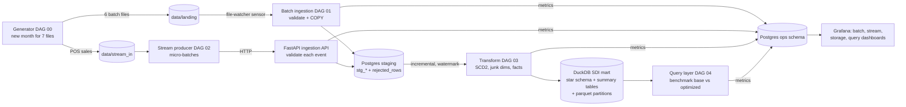

# Pharma Cold Chain DWH + BI Pipeline — Phase 1: Sales & Demand Intelligence (SDI)

Intelligent Data Architectures, Fall 2026 · Milestone 1 (pipeline up to the query layer)

**Group members:** Qadrain Qadir, Muhammad Alam

An automated data-engineering pipeline, run by **Apache Airflow**, that:

1. **generates** new monthly data for all 7 source files (oversampling layer)
2. **ingests** it: batch files through a Python file-watcher, and point-of-sale sales as a **live event stream** through a FastAPI ingestion API
3. **validates and stores** it in a **Postgres** staging area (ODS)
4. **transforms** it into a **DuckDB star schema** (SCD Type 2, junk and role-playing dimensions, two fact types)
5. **optimizes and benchmarks** the analytical queries (summary tables, indexes, partitions)
6. records **monitoring metrics** for every step, shown on **4 Grafana dashboards**

New data is always **added** to the warehouse. History is never wiped.



## What is in the repo

| Path | What it is |
|---|---|
| `dags/` | 6 Airflow DAGs: `sdi_00_generate_data`, `sdi_01_batch_ingestion`, `sdi_02_stream_ingestion`, `sdi_03_transform_mart`, `sdi_04_query_layer`, plus `sdi_99_master_refresh`, which runs them in order |
| `src/pipeline/` | All pipeline logic as a Python package (the DAGs only call it) |
| `src/pipeline/sql/` | DDL: ops (monitoring) schema, staging schema, star schema, summary tables |
| `grafana/` | Datasource + 4 dashboards, provisioned automatically (`build_dashboards.py` builds the JSON) |
| `docs/Data_Generation_Report.pdf` | 2-page report: data generation logic and statistics |
| `docs/Phase1_SDI_Data_Mart.xlsx` | Phase 1 Excel file: bus matrix, data dictionary, source-to-target mapping, validation rules, refresh log, KPI results, query performance |
| `docs/laptop_run_results.json` | All monitoring figures from the real laptop run (used by the PDF and Excel) |
| `docs/dashboards/01_batch_ingestion_laptop_run.png` | Screenshot of the live batch dashboard from the laptop run |
| `docs/dashboards/0*_*.png` (others) | Layout previews drawn on our Linux development machine, **not** laptop results |
| `docker-compose.yml` | Postgres 16, Airflow 2.11 (webserver + scheduler), ingestion API, Grafana 11 |

## How to run it

**Needs:** Docker Desktop (about 4 GB RAM free).

1. **Add the data.** The source CSVs are too big for GitHub (the sales file is 218 MB), so they are git-ignored. Copy the 7 files into `data/source/` with their original names (`01_master_data.csv` … `07_iot_streaming_data.csv`).
2. **Start everything** (Linux only: first run `echo "AIRFLOW_UID=$(id -u)" > .env`):
   ```bash
   docker compose up -d --build
   ```
   - Airflow: http://localhost:8080 (admin / admin)
   - Grafana: http://localhost:3000 (admin / admin), folder "Pharma SDI - Phase 1"
   - Ingestion API docs: http://localhost:8000/docs
3. **Initial load.** In Airflow, trigger **`sdi_99_master_refresh`** with config `{"refresh_id": 0}`. This loads the full 2023–2025 history (about 2–3 minutes).
4. **Refresh 1.** Trigger it again with `{"refresh_id": 1}`. This generates January 2026, streams the new sales, and updates the mart and the dashboards.
5. **Refresh 2.** Trigger it again with `{"refresh_id": 2}` (February 2026).

Keep the Grafana dashboards open during steps 4–5. They auto-refresh every 10 s, so you can see the numbers change live in the demo.

Optional: `docker compose --profile watcher up -d file-watcher` starts a 24/7 watchdog daemon. It triggers the ingestion DAGs as soon as a file lands, including files uploaded through `POST /ingest/file?name=<file>.csv` (raw CSV as the request body).

## Layers

### 1. Data oversampling (`generator.py`, DAG 00)
Each refresh adds one calendar month for all 7 files. Rows per refresh = **median monthly volume of the last 12 months**. Sampled real rows are time-shifted into the new month, and dependent fields (prices, margins, stock balances) are recomputed. Master data is re-sent with 4 changes per refresh to exercise SCD Type 2. About 0.2–0.4% of rows are deliberately broken to test validation. Full reasoning is in `docs/Data_Generation_Report.pdf`.

### 2. Ingestion (DAG 01 batch, DAG 02 stream, `api.py`)
- **Batch:** `wait_for_files` is a Python file-watcher sensor. It only fires once a file has stopped growing. Master data loads first (sales validation checks MedicineIDs against it), then the other files load in parallel via dynamic task mapping.
- **Stream:** new POS sales are sent as micro-batches of 50 events at a fixed rate to `POST /stream/sales`. The API validates every event in a try/except counter and commits the good ones.
- **Validation:** non-null keys, valid dates, numeric types, price > 0, quantity > 0, known SKU, and no negative quantities. Bad rows go to `staging.rejected_rows` with the reason.
- **Metrics:** load duration, rows processed, and success rate (batch); throughput, end-to-end latency, and malformed/dropped counts (stream).

### 3. Storage & staging (Postgres)
`staging.stg_*` holds one typed table per source file. Every row carries `_load_id`, `_source_file` and `_ingested_at` (lineage). The storage snapshot records row counts, MB per table (`pg_total_relation_size`, plus `os.path.getsize` for the DuckDB file) and date coverage.

### 4. Transformation & dimensional modeling (DAG 03, DuckDB)
| Table | Type | Notes |
|---|---|---|
| `fact_sales` | transaction fact | 1 row per sale; degenerate dims: transaction, prescription, lot and batch IDs |
| `fact_hospital_demand` | periodic snapshot | 1 row per hospital × medicine × month; stock columns are semi-additive |
| `dim_date` | conformed, **role-playing** | sale date, delivery date, expiry date, demand month |
| `dim_medicine` | conformed, **SCD Type 2** | price/cost/safety-stock/status changes create new versions; facts look up the version valid on the sale date |
| `dim_pharmacy`, `dim_hospital` | SCD Type 1 | unknown member key `-1` |
| `dim_sales_profile` | **junk dimension** | 10 low-cardinality flags (channel, payer, payment, promo, return …) in one key |
| `dim_demand_status` | junk dimension | request status + formulary status |

Loads are **incremental**, using a watermark per source in `ops.etl_watermark`, and **idempotent** (`INSERT OR IGNORE`), so re-running a DAG never duplicates rows. A quality gate fails the run if there are orphan facts or two "current" versions of one medicine.

### 5. Query layer & optimization (DAG 04)
9 dashboard queries, each in two versions: **base** (star-schema joins) and **optimized**. The optimizations are summary tables `agg_sales_monthly` / `agg_demand_monthly` (DuckDB has no materialized views, so these play that role), a date-sorted fact (zone maps), ART indexes, and year/month parquet partitions. Both versions are checked to return identical results. Each runs 5× per refresh, and every run is logged to `ops.query_log` (time, rows, success/failure).

## The 4 monitoring dashboards (what they tell)
Numbers below are from our real run on the team laptop (Windows + Docker Desktop, 26 Nov 2026). The full figures are in `docs/laptop_run_results.json`, and a screenshot of the live batch dashboard is in `docs/dashboards/01_batch_ingestion_laptop_run.png`.

1. **Batch Ingestion:** success rate, rows loaded and rejected, load time per file, and rejected rows by reason. The 500,000-row sales file is clearly the slowest at **63 s**, followed by IoT (31 s) and warehouse (15 s). The success rate shows **86.4% (19 of 22 loads)**. The 3 failures are real: the hospital file failed 3 times in the initial load because of a pandas-version bug, then loaded fine after the fix. This shows the success-rate KPI catching an actual problem.
2. **Streaming Ingestion:** throughput per second for each refresh run: **324 events/s** (refresh 1) and **372 events/s** (refresh 2). Average end-to-end delay was **0.07–0.08 s** per event (p95 about 0.11 s). 28 malformed events were caught in each refresh, and **0 events were dropped**.
3. **Storage:** after refresh 2, staging holds **974,852 rows (480 MB)** and the DuckDB mart **577,746 rows (71 MB)**. Sales is 53% of staging rows. There's also row growth per refresh, and a date-coverage check showing 2023–2025 fully present plus Jan and Feb 2026.
4. **Query Performance:** 360 query runs, **0% error rate**. Summary tables made 8 of the 9 widget queries faster, by **1.2–5.1×** (e.g. KPI cards 17.0 → 3.4 ms, monthly revenue trend 13.9 → 3.2 ms). The exception is the parquet **partition scan**: it was **40× slower** (5 → 205 ms), because reading parquet files from a Windows folder mounted into Docker is slow. On our Linux test machine it was only about 1.6× slower. At this data size, the native DuckDB table beats partitioned parquet.

## Results of the laptop run (initial load + 2 refreshes)
| | Rows loaded | Rows rejected | `fact_sales` | `fact_hospital_demand` | `dim_medicine` rows |
|---|---|---|---|---|---|
| Refresh 0 (2023–2025) | 934,448 | 0 | 500,000 | 27,216 | 63 |
| Refresh 1 (Jan 2026) | 20,244 batch + 7,086 stream | 55 | 507,086 | 27,970 | 67 |
| Refresh 2 (Feb 2026) | 20,160 batch + 7,053 stream | 54 | 514,139 | 28,724 | 71 |

- **109 deliberately broken rows** were injected (55 + 54), and validation rejected exactly those 109.
- `dim_medicine` grows by 4 rows per refresh. These are the SCD Type 2 versions created by the price and safety-stock changes; sales in each month link to the price valid on the sale date.

## Assumptions
- Channel groups: `Ecommerce` → E-commerce; physical sale at a `Hospital Pharmacy` → Hospital; everything else → Retail.
- "Implement an API for ingestion" is read as a REST ingestion service (FastAPI) that receives files and events.
- Phase 1 streaming uses POS sales, because the IoT stream belongs to Phase 3. Latency = DB commit time − time the producer created the event.
- Postgres size comes from `pg_total_relation_size()`, because Postgres runs in another container where `os.path.getsize()` can't see its files. The DuckDB per-table MB is the file size split by row share.
- The content of the "Excel file Phase 1" is not defined in the brief; `docs/Phase1_SDI_Data_Mart.xlsx` is our interpretation.
- Files 02, 03, 04 and 07 are generated and staged now but only modeled in Phases 2 and 3.

## Re-building the docs
```bash
python grafana/build_dashboards.py              # dashboard JSON
python scripts/render_dashboard_previews.py     # layout previews from the local ops tables (development only)
python scripts/build_generation_report.py       # PDF report (reads docs/laptop_run_results.json)
python scripts/build_phase1_excel.py            # Excel file (reads docs/laptop_run_results.json)
```
